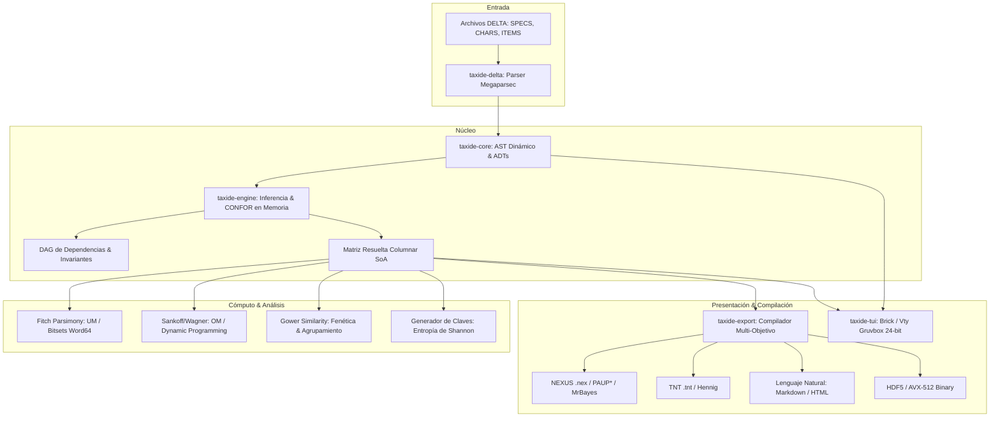
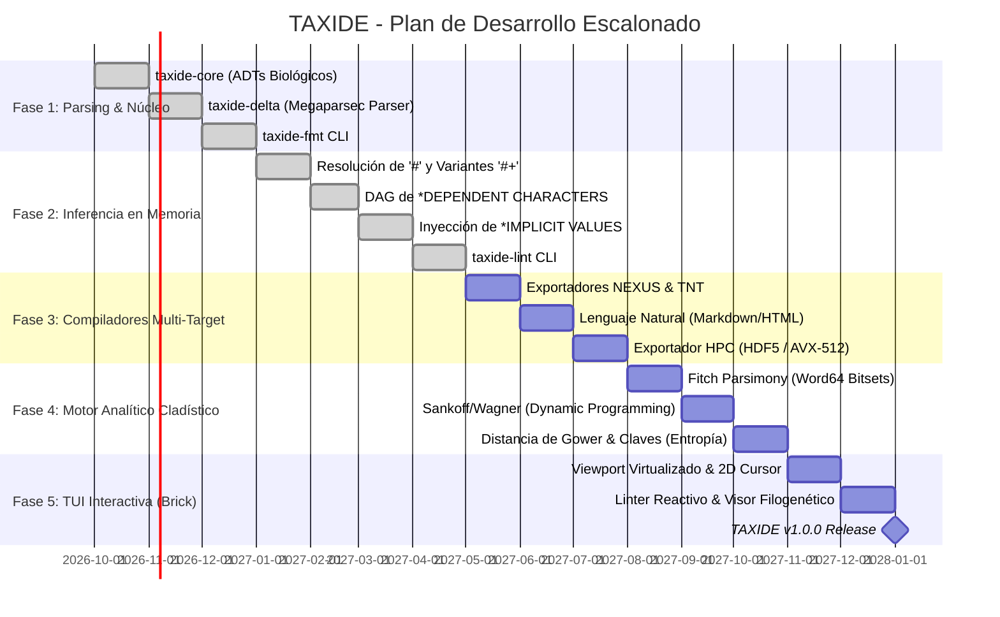

# TAXIDE: Taxonomic Integrated Development Environment

<p align="center">
  <strong>Tratando la Taxonomía como Código: Un entorno formal de terminal (TUI) escrito 100% en Haskell para la descripción, validación y cómputo de matrices morfológicas.</strong>
</p>

<p align="center">
  <a href="LICENSE"></a>
  <a href="https://www.haskell.org/"></a>
  <a href="https://www.haskell.org/ghc/"></a>
  <a href="https://cabal.readthedocs.io/"></a>
  <a href="CITATION.cff"></a>
</p>

---

## 🔬 Visión del Proyecto

Durante más de cuatro décadas, la sistemática morfológica ha dependido del estándar **CSIRO DELTA** (*DEscription Language for TAxonomy*) y de envoltorios de interfaz gráfica que fragmentan las descripciones en múltiples archivos planos (`SPECS`, `CHARS`, `ITEMS`, `CNOTES`) y orquestan ejecutables legados monolíticos de 16/32 bits (`CONFOR`, `KEY`, `DIST`) a través de archivos binarios temporales en disco.

**TAXIDE** reemplaza este paradigma obsoleto tratando la **taxonomía como código**:
* **Árbol de Sintaxis Abstracta (AST) Inmutable:** Modela la riqueza de la biología morfológica mediante Tipos de Datos Algebraicos (ADTs), convirtiendo estados inválidos en irrepresentables por construcción.
* **Linter/LSP Taxonómico en Tiempo Real:** Validación estática instantánea de dependencias biológicas, ciclos y compatibilidad de tipos sin invocar procesos externos.
* **Motor Analítico Puro en Memoria:** Eliminación total de CONFOR, KEY y DIST mediante funciones matemáticas puras con complejidad asintótica acotada.
* **Cladística y Fenética de Alto Rendimiento:** Algoritmos nativos de máxima parsimonia (Fitch y Sankoff/Wagner) y matrices de distancia (coeficiente de Gower) paralelizables con `Control.Parallel.Strategies` y optimizados por hardware (`Word64` bitsets).
* **Compilador Multi-Objetivo:** Proyección isomórfica hacia NEXUS, TNT, JSON/GeoJSON, descripciones florísticas en lenguaje natural (Markdown/HTML) y tensores binarios HDF5 listos para vectorización AVX-512 en Fortran/C++.
* **Terminal UI Moderna (TUI):** Construida con `brick` y `vty` sobre una arquitectura Model-View-Update, paleta *Gruvbox Dark 24-bit TrueColor* y ergonomía modal estilo VIM.

---

## 🏛️ Arquitectura del Sistema

TAXIDE se estructura como un monorepositorio multi-paquete gobernado por `cabal.project`, asegurando aislamiento estricto de responsabilidades:



### Paquetes del Workspace

| Paquete | Descripción | Dependencias Clave |
|---|---|---|
| [`taxide-core`](taxide-core) | Definiciones de tipos fundamentales, pseudo-valores (`'U'`, `'-'`, `'V'`), rangos estadísticos e invariantes. | `base`, `vector`, `deepseq`, `containers` |
| [`taxide-delta`](taxide-delta) | Parser combinatorio resiliente en `Megaparsec` para directivas DELTA y comentarios anidados `<...>`. | `megaparsec`, `text`, `filepath` |
| [`taxide-engine`](taxide-engine) | Inferencia lógica en memoria: herencia de variantes (`#+`), DAG reactivo, Fitch, Sankoff, Gower y Claves. | `vector-algorithms`, `parallel`, `primitive` |
| [`taxide-export`](taxide-export) | Transpilador cross-target hacia NEXUS, TNT, Darwin Core Archive (DwC-A / GBIF), JSON, Markdown/HTML y HDF5. | `aeson`, `zip-archive`, `xml-conduit`, `prettyprinter` |
| [`taxide-tui`](taxide-tui) | Interfaz gráfica interactiva de terminal en 24 bits con edición de hojas de cálculo y linter en vivo. | `brick >= 2.3`, `vty`, `microlens` |
| [`taxide-app`](taxide-app) | Punto de entrada del ejecutable CLI (`taxide`). | `optparse-applicative` |
| [`doc`](doc) | Manifiesto fundacional, especificación matemática (`.tex`), Runbook operativo (`RUNBOOK.md`) y compilador (`pdfltex.hs`). | LaTeX / Docker TeXLive |

---

## ⚡ Quick Start (Inicio Rápido en 3 Minutos)

¿Listo para tratar la taxonomía como código? Sigue estos pasos para compilar TAXIDE, verificar las invariantes biológicas y procesar un dataset de ejemplo:

### 1. Clonar y Compilar
```bash
# Clonar y compilar todos los paquetes del espacio de trabajo
git clone https://github.com/ecotech/taxide.git
cd taxide
cabal update
cabal build all
```

### 2. Validar y Normalizar un Dataset DELTA con `taxide-fmt`
```bash
# Validar la sintaxis de un dataset (Modo auditoría / CI)
cabal run taxide-fmt -- -i examples/craspedacusta --check

# Reformatear canónicamente el dataset sin pérdida semántica
cabal run taxide-fmt -- -i examples/craspedacusta -o ./craspedacusta_canonical
```

### 3. Auditar Invariantes Biológicas e Inferir Estados con `taxide-lint`
```bash
# Ejecutar pipeline de inferencia semántica y ver métricas SoA en memoria
cabal run taxide-lint -- -i examples/craspedacusta -v

# Exportar diagnósticos ontológicos en formato JSON estructurado
cabal run taxide-lint -- -i examples/craspedacusta --json
```

### 4. Ejecutar las Pruebas Formales y de Propiedades
```bash
# Correr pruebas unitarias (invariantes biológicas) y pruebas basadas en propiedades (Hedgehog)
cabal test all --test-show-details=streaming
```

### 5. Compilar la Especificación Formal a PDF
```bash
# Compilar el manifiesto matemático (detección automática: pdflatex nativo o contenedor Docker)
runhaskell doc/pdfltex.hs doc/taxide.tex
```

> 📖 **¿Buscas operaciones avanzadas, flujos CI/CD o resolución de incidencias?**
> Consulta el **[Manual de Operaciones y Runbook Técnico (`doc/RUNBOOK.md`)](doc/RUNBOOK.md)** para una guía exhaustiva de administración, transpilación Darwin Core Archive (DwC-A), motores cladísticos y recetas paso a paso.

---

## 📐 Fundamentos Matemáticos

TAXIDE enruta automáticamente cada carácter hacia su kernel matemático según su **Tipo Algebraico de Datos**:

### 1. Algoritmo de Fitch (Multiestado Desordenado — `UM`)
Para caracteres donde toda transición de estado cuesta $1$ paso evolutivo:
$$
S_A = \begin{cases} 
S_L \cap S_R & \text{si } S_L \cap S_R \neq \emptyset \quad (\Delta c = 0) \\
S_L \cup S_R & \text{si } S_L \cap S_R = \emptyset \quad (\Delta c = 1)
\end{cases}
$$
Implementado en hardware mediante operaciones a nivel de bit vectorizables sobre `Word64`: `S_L .&. S_R` y `S_L .|. S_R`.

### 2. Algoritmo de Sankoff/Wagner (Multiestado Ordenado — `OM`)
Para caracteres ordenados ($1 \leftrightarrow 2 \leftrightarrow 3$) o matrices de paso asimétricas ($w(i,j)$):
$$
C_A(i) = \min_{j \in \mathcal{S}} \Big[ C_L(j) + w(i, j) \Big] + \min_{k \in \mathcal{S}} \Big[ C_R(k) + w(i, k) \Big]
$$
Evaluado mediante un catamorfismo de árbol en programación dinámica con vectores unboxed inmutables.

### 3. Coeficiente de Similitud de Gower (Distancia Fenética)
Mantiene paridad estricta con el módulo `DIST` de DELTA para matrices morfológicas mixtas (cualitativas y cuantitativas):
$$
S_{ij} = \frac{\sum_{k=1}^n w_{ijk} \, s_{ijk}}{\sum_{k=1}^n w_{ijk}}, \qquad D_{ij} = 1 - S_{ij}
$$
donde $s_{ijk}$ normaliza variables continuas por su rango total $R_k = \max(x_k) - \min(x_k)$ y enmascara ausencias biológicas con $w_{ijk} = 0$.

> 📄 Para la formulación matemática completa, consulta el [Manifiesto Formal de TAXIDE (PDF)](doc/taxide.pdf) o su código fuente en [`doc/taxide.tex`](doc/taxide.tex).

---

## 🗺️ Roadmap de Desarrollo Escalonado

El desarrollo de TAXIDE se ejecuta a través de cinco fases lógicas incrementales y formalmente verificables. Cada fase garantiza invariantes biológicas y matemáticas antes de habilitar la siguiente capa arquitectónica:



### Detalle de Fases de Ingeniería

#### 🟢 Fase 1: Núcleo Semántico Biológico y Analizador Sintáctico Resiliente
* **Paquetes:** [`taxide-core`](taxide-core), [`taxide-delta`](taxide-delta)
* **Objetivos Técnicos:**
  - Tipado algebraico estricto para los 5 tipos de caracteres (`UM`, `OM`, `IN`, `RN`, `TE`) y pseudo-valores biológicos (`'U'`, `'-'`, `'V'`).
  - Separación explícita de `itemAuthority :: !(Maybe Text)` en `ItemDef` (extracción de autoría/año desde comentarios angulares `<...>`) y estructura `DatasetMetadata` en `taxide-core` para nutrir descriptores EML (`eml.xml`).
  - Representación de estadística cuantitativa nativa con extremos y rangos: `StatRange a` (mínimo/máximo absolutos y rangos normales con valor central).
  - Parser combinatorio con `Megaparsec` capaz de desambiguar el operador `/` (terminador vs. *OR* lógico vs. texto literal), directivas de tres letras (`*NUM OF CHA`) y comentarios anidados `<...>`.
* **Estrategia de Pruebas:**
  - *Property-Based Testing* con `Hedgehog`: Demostración formal de la propiedad de *Round-Trip* sintáctico ($\forall a \in \text{AST}, \text{parse}(\text{render}(a)) \equiv \text{Right}(a)$).
  - *Golden Tests* con matrices canónicas históricas de CSIRO (*Grass Genera of the World*, *Craspedacusta*), incluyendo extracción de autoridades taxonómicas.
* **🎯 Hito Entregable (Milestone 1):** CLI `taxide-fmt` para parseo, validación léxica y reformateo canónico sin pérdida semántica.

#### 🟢 Fase 2: Motor de Resolución Semántica e Inferencia en Memoria (Reemplazo de CONFOR) [COMPLETADA]
* **Paquete:** [`taxide-engine`](taxide-engine)
* **Objetivos Técnicos:**
  - Resolución monoidal estricta de herencia para ítems variantes (`#+`).
  - Representación y compilación del Grafo Acíclico Dirigido (DAG) de `*DEPENDENT CHARACTERS` para invalidación reactiva de estados dependientes.
  - Inyección determinista de `*IMPLICIT VALUES` para caracteres omitidos ($s$) o no puntuados ($t$).
  - Discretización dinámica en memoria de variables continuas a discretas (`IN`/`RN` $\to$ `OM`) mediante la Regla de Sturges ($k = \lceil 1 + 3.322 \log_{10}(N) \rceil$) y Raíz Cuadrada ($\lceil \sqrt{N} \rceil$).
  - Transposición a Matriz Resuelta Columnar SoA (`Vector.Unboxed`).
* **Estrategia de Pruebas:**
  - *Differential Testing* contra binarios intermedios de CONFOR (`KCHARS`, `KITEMS`), verificando paridad de estados celda por celda.
  - Pruebas unitarias sobre invariantes de exclusión mutua en dependencias del DAG.
* **🎯 Hito Entregable (Milestone 2):** Herramienta `taxide-lint` para auditoría y emisión de diagnósticos biológicos con tiempo de resolución $<50\text{ ms}$ en matrices de más de 500 taxones.

#### 🟠 Fase 3: Compiladores Multi-Target e Integración HPC
* **Paquete:** [`taxide-export`](taxide-export)
* **Objetivos Técnicos:**
  - Exportador a NEXUS (`.nex`) con bloques `TAXA`, `CHARACTERS` (etiquetando `DATATYPE=STANDARD` y polimorfismos) y `ASSUMPTIONS` (`TYPESET`).
  - Exportador a TNT (`.tnt`) con cabeceras compactas `xread`, pesos y `ccode`.
  - Módulo `Taxide.Export.DarwinCore` y bandera `--target dwca` en `taxide-compile` para proyectar la matriz resuelta al Esquema en Estrella (Star Schema) de GBIF:
    - Core `taxon.txt` (`dwc:Taxon` con `scientificName`, `scientificNameAuthorship` y variantes `#+` subordinadas vía `parentNameUsageID`).
    - Extensión `measurementorfact.txt` (`dwc:MeasurementOrFact` excluyendo estados `Unknown` e `Inapplicable`).
    - Extensión `description.txt` (`gbif:Description` para textos descriptivos y síntesis natural).
    - Generación en memoria de `meta.xml` y `eml.xml` empaquetados en un archivo ZIP determinista mediante `Codec.Archive.Zip` sin intermediación en disco.
  - Motor de síntesis en lenguaje natural que traduce atributos a prosa botánica/zoológica fluida en Markdown y HTML (reemplazando `TONAT`).
  - Serializador JSON/GeoJSON vía `aeson` con esquemas tipados listos para bases de datos relacionales y geoespaciales (PostGIS).
  - Exportador HPC Columnar a HDF5/Binario alineado a 64 bytes para procesamiento SIMD/AVX-512 en motores numéricos externos.
* **Estrategia de Pruebas:**
  - Validación externa de sintaxis cargando matrices generadas directamente en herramientas estándar (`paup`, `tnt`, `ncl`).
  - Pruebas de validación de esquema XML (`meta.xml`, `eml.xml`) y consistencia relacional TSV para paquetes Darwin Core Archive (`dwca`).
  - *Golden Tests* de descripciones en lenguaje natural contra publicaciones de referencia.
* **🎯 Hito Entregable (Milestone 3):** Pipeline de compilación `taxide compile --target=[nexus|tnt|dwca|natural|json|hdf5]` totalmente automatizado.

#### 🔵 Fase 4: Motor Analítico Cladístico y Generador de Claves Dicotómicas
* **Paquete:** [`taxide-engine`](taxide-engine)
* **Objetivos Técnicos:**
  - Máxima parsimonia de Fitch implementada a nivel de hardware con operaciones sobre `Word64` bitsets ($O(1)$ por nodo).
  - Algoritmo de Sankoff/Wagner para caracteres ordenados mediante programación dinámica sobre árboles con matrices de costo de paso.
  - Búsqueda heurística de árboles (TBR / SPR) paralelizada de forma determinista con `Control.Parallel.Strategies` (`parListChunk 64 rdeepseq`).
  - Matriz de similitud y distancias fenéticas de Gower para agrupamiento UPGMA y Neighbor-Joining.
  - Generador de claves dicotómicas óptimas basado en ganancia de información (Entropía de Shannon), penalizando costos empíricos de observación de caracteres.
* **Estrategia de Pruebas:**
  - Verificación de parsimonia: comprobación de longitud de árbol óptimo contra benchmarks conocidos en PAUP* y TNT (coincidencia de puntuación al 100%).
  - Verificación de unicidad de rutas en claves dicotómicas generadas sin ambigüedad biológica.
* **🎯 Hito Entregable (Milestone 4):** Subcomandos `taxide tree` y `taxide key` que generan cladogramas y claves de identificación en segundos.

#### 🟣 Fase 5: Terminal User Interface (TUI) y Linter en Vivo
* **Paquetes:** [`taxide-tui`](taxide-tui), [`taxide-app`](taxide-app)
* **Objetivos Técnicos:**
  - Arquitectura reactiva Model-View-Update (MVU) en `brick` y `vty` sobre terminales con paleta Gruvbox Dark y soporte TrueColor de 24 bits.
  - Navegación modal estilo VIM (Normal, Insert, Visual, Command) con cursor 2D y virtualización de viewport para garantizar $60\text{ FPS}$ constantes en datasets masivos.
  - Propagación de modificaciones en tiempo $O(\text{deg}^+(C))$ mediante *overlay delta maps*, actualizando el estado de celdas dependientes sin congelar la interfaz.
  - Vistas integradas: Hoja de cálculo matricial, editor modal de atributos con autocompletado, panel de alertas del linter taxonómico en vivo y visor de árboles en caracteres ASCII/Unicode.
* **Estrategia de Pruebas:**
  - Pruebas *headless* de Brick inyectando secuencias de eventos de teclado sintéticos.
  - Perfilado de memoria y CPU con `+RTS -s -p` para certificar la erradicación de fugas de memoria durante sesiones de edición prolongadas.
* **🎯 Hito Entregable (Milestone 5 - v1.0.0):** Suite completa TAXIDE distribuible como un único ejecutable binario estático optimizado con GHC `-O2 -threaded`.

---

## 🚀 Instalación y Construcción

### Requisitos Previos
* **GHC:** 9.10.x o superior (gestionado preferiblemente mediante [GHCup](https://www.haskell.org/ghcup/))
* **Cabal:** 3.12.x o superior
* **Docker:** (Opcional) para compilar la documentación PDF con la imagen `texlive/texlive:latest-medium`

### Compilación desde el Código Fuente

```bash
# 1. Clonar el repositorio
git clone https://github.com/ecotech/taxide.git
cd taxide

# 2. Actualizar el índice de paquetes y compilar
cabal update
cabal build all

# 3. Ejecutar las suites de pruebas y verificación de invariantes
cabal test all --test-show-details=streaming
```

---

## 💻 Uso de la Línea de Comandos (CLI)

TAXIDE ofrece un conjunto intuitivo de subcomandos para operar en terminal o en pipelines de CI/CD:

```bash
# Iniciar el entorno interactivo TUI (Gruvbox Dark)
taxide tui --dataset=./craspedacusta/

# Validar y diagnosticar una colección DELTA (Linter taxonómico)
taxide lint --specs=SPECS --chars=CHARS --items=ITEMS

# Normalizar y reformatear canónicamente archivos DELTA heredados
taxide fmt --input-dir=./legacy_delta/ --output-dir=./clean_delta/

# Transpilar a formatos cladísticos y estándares de biodiversidad global (DwC-A)
taxide compile --specs=SPECS --chars=CHARS --items=ITEMS --target=nexus -o matrix.nex
taxide compile --specs=SPECS --chars=CHARS --items=ITEMS --target=tnt   -o matrix.tnt
taxide compile --specs=SPECS --chars=CHARS --items=ITEMS --target=dwca  -o craspedacusta_dwca.zip

# Generar descripciones taxonómicas en lenguaje natural (Markdown)
taxide describe --items=ITEMS -o flora_descriptions.md

# Búsqueda de cladogramas de máxima parsimonia
taxide tree --input=SPECS,CHARS,ITEMS --algorithm=fitch --threads=8 -o best_tree.nwk

# Generar clave dicotómica de identificación basada en ganancia de información
taxide key --input=SPECS,CHARS,ITEMS --entropy=shannon -o identification_key.txt
```

---

## 📑 Compilación de Documentación

El repositorio incluye un compilador inteligente en Haskell puro ([`doc/pdfltex.hs`](doc/pdfltex.hs)) con fallback automático a Docker:

```bash
# Compilar el manifiesto matemático a PDF
runhaskell doc/pdfltex.hs doc/taxide.tex

# Limpiar archivos auxiliares tras la compilación
runhaskell doc/pdfltex.hs doc/taxide.tex --clean
```

---

## 🤝 Contribuciones

Agradecemos profundamente las contribuciones de la comunidad científica y de ingeniería funcional. Por favor, lee nuestra [Guía de Contribución](CONTRIBUTING.md) para conocer las directrices de pruebas de propiedades (`Hedgehog`), disciplina de estrictez (`StrictData`) y estilo de código.

Todos los participantes deben adherirse a nuestro [Código de Conducta](CODE_OF_CONDUCT.md).

---

## 📜 Citación y Licencia

Si utilizas TAXIDE en investigaciones académicas, sistemática biológica o proyectos de cómputo evolutivo, por favor cita el proyecto utilizando los metadatos provistos en [`CITATION.cff`](CITATION.cff).

Distribuido bajo los términos de la Licencia **Apache-2.0**. Consulta el archivo [`LICENSE`](LICENSE) para más detalles.

---

<p align="center">
  <sub>Desarrollado con pasión funcional por el <strong>TAXIDE Architecture & Scientific Computing Team</strong> (2026).</sub>
</p>
