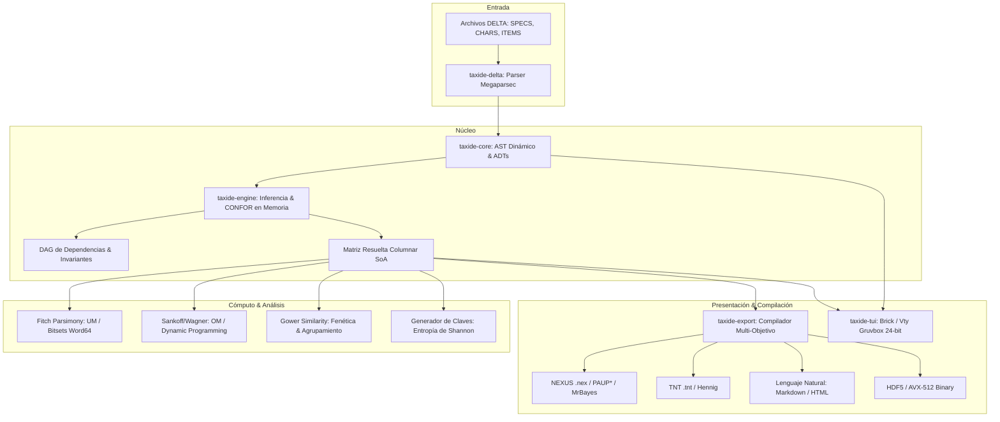
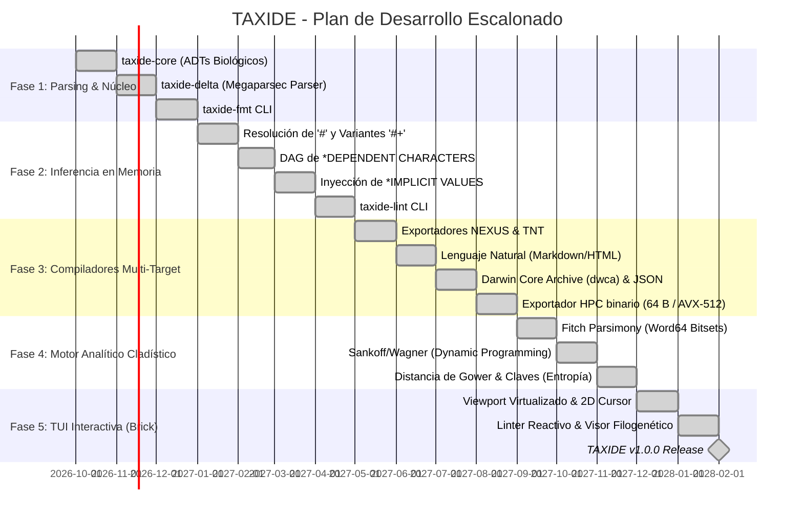

# TAXIDE: Taxonomic Integrated Development Environment

<p align="center">
  <strong>Tratando la Taxonomía como Código: Un entorno formal de terminal (TUI) escrito 100% en Haskell para la descripción, validación y cómputo de matrices morfológicas.</strong>
</p>

<p align="center">
  <a href="LICENSE"></a>
  <a href="https://www.haskell.org/"></a>
  <a href="https://www.haskell.org/ghc/"></a>
  <a href="https://cabal.readthedocs.io/"></a>
  <a href="CITATION.cff"></a>
</p>

---

## 🔬 Visión del Proyecto

Durante más de cuatro décadas, la sistemática morfológica ha dependido del estándar **CSIRO DELTA** (*DEscription Language for TAxonomy*) y de envoltorios de interfaz gráfica que fragmentan las descripciones en múltiples archivos planos (`SPECS`, `CHARS`, `ITEMS`, `CNOTES`) y orquestan ejecutables legados monolíticos de 16/32 bits (`CONFOR`, `KEY`, `DIST`) a través de archivos binarios temporales en disco.

**TAXIDE** reemplaza este paradigma obsoleto tratando la **taxonomía como código**:
* **Árbol de Sintaxis Abstracta (AST) Inmutable:** Modela la riqueza de la biología morfológica mediante Tipos de Datos Algebraicos (ADTs), convirtiendo estados inválidos en irrepresentables por construcción.
* **Linter/LSP Taxonómico en Tiempo Real:** Validación estática instantánea de dependencias biológicas, ciclos y compatibilidad de tipos sin invocar procesos externos.
* **Motor Analítico Puro en Memoria:** Eliminación total de CONFOR, KEY y DIST mediante funciones matemáticas puras con complejidad asintótica acotada.
* **Cladística y Fenética de Alto Rendimiento:** Algoritmos nativos de máxima parsimonia (Fitch y Sankoff/Wagner) y matrices de distancia (coeficiente de Gower) paralelizables con `Control.Parallel.Strategies` y optimizados por hardware (`Word64` bitsets).
* **Compilador Multi-Objetivo:** Proyección isomórfica hacia NEXUS, TNT, JSON/GeoJSON, descripciones florísticas en lenguaje natural (Markdown/HTML) y tensores binarios HDF5 listos para vectorización AVX-512 en Fortran/C++.
* **Terminal UI Moderna (TUI):** Construida con `brick` y `vty` sobre una arquitectura Model-View-Update, paleta *Gruvbox Dark 24-bit TrueColor* y ergonomía modal estilo VIM.

---

## 🏛️ Arquitectura del Sistema

TAXIDE se estructura como un monorepositorio multi-paquete gobernado por `cabal.project`, asegurando aislamiento estricto de responsabilidades:



### Paquetes del Workspace

| Paquete | Descripción | Dependencias Clave |
|---|---|---|
| [`taxide-core`](taxide-core) | Definiciones de tipos fundamentales, pseudo-valores (`'U'`, `'-'`, `'V'`), rangos estadísticos e invariantes. | `base`, `vector`, `deepseq`, `containers` |
| [`taxide-delta`](taxide-delta) | Parser combinatorio resiliente en `Megaparsec` para directivas DELTA y comentarios anidados `<...>`. | `megaparsec`, `text`, `filepath` |
| [`taxide-engine`](taxide-engine) | Inferencia lógica en memoria: herencia de variantes (`#+`), DAG reactivo, Fitch, Sankoff, Gower y Claves. | `vector-algorithms`, `parallel`, `primitive` |
| [`taxide-export`](taxide-export) | Transpilador cross-target hacia NEXUS, TNT, Darwin Core Archive (DwC-A / GBIF), JSON, Markdown/HTML y HDF5. | `aeson`, `zip-archive`, `xml-conduit`, `prettyprinter` |
| [`taxide-tui`](taxide-tui) | Interfaz gráfica interactiva de terminal en 24 bits con edición de hojas de cálculo y linter en vivo. | `brick >= 2.3`, `vty`, `microlens` |
| [`taxide-app`](taxide-app) | Punto de entrada del ejecutable CLI maestro (`taxide`). | `optparse-applicative` |
| [`doc`](doc) | Manifiesto fundacional, especificación matemática (`.tex`), Runbook operativo (`RUNBOOK.md`) y compilador (`pdfltex.hs`). | LaTeX / Docker TeXLive |

---

## ⚡ Quick Start (Inicio Rápido para Humanos en 60 Segundos)

TAXIDE está diseñado para que cualquier taxónomo, biólogo o investigador pueda abrir, editar y analizar sus matrices de especies de inmediato, sin lidiar con programas obsoletos de MS-DOS ni configuraciones complejas.

> ### 💡 ¿Qué es `fmt` y por qué existía `taxide-fmt`?
> * **¿Qué significa `fmt`?** Es la abreviatura estándar en informática de **«formatter»** (formateador de texto o código, equivalente a lo que hace *Prettier*, *gofmt* o *rustfmt*).
> * **¿Para qué sirve?** En taxonomía, los archivos de texto DELTA (`SPECS`, `CHARS`, `ITEMS`) a menudo fueron escritos a mano hace décadas, con sangrías irregulares o comentarios desalineados. El comando `taxide fmt` lee esos archivos y los reescribe de forma limpia, alineada y uniforme (formato canónico) sin tocar los datos biológicos, o verifica si contienen errores de sintaxis con `--check`.
> * **¿Por qué existía `taxide-fmt`?** Durante las primeras fases de desarrollo cada módulo tenía su propia herramienta (`taxide-fmt`, `taxide-lint`, `taxide-tree`, etc.). **En la versión actual v1.0.0 todo está unificado en un solo comando maestro:** `taxide`. Ya no necesitas recordar nombres raros.

---

### Paso 1: Clonar y Compilar

```bash
git clone https://github.com/ecotech/taxide.git
cd taxide
cabal update
cabal build all
```

> **Nota:** Al ser un proyecto multi-paquete, Cabal requiere la palabra `all` (`cabal build all`). También puedes saltarte este paso y ejecutar directamente `cabal run taxide -- -d examples/craspedacusta` (Cabal compilará automáticamente lo necesario).

---

### Paso 2: ¡Arrancar la Interfaz Visual (TUI)!

Para abrir el dataset de ejemplo (*Craspedacusta*, medusas de agua dulce) en la interfaz interactiva de terminal, simplemente ejecuta:

```bash
cabal run taxide -- -d examples/craspedacusta
```

*(Si instalaste el binario en tu sistema, basta con teclear: `taxide -d examples/craspedacusta`)*

¡Y listo! Aparecerá la matriz completa en tu terminal con colores semánticos:
* **Ratón:** Haz clic en cualquier celda para seleccionarla; haz doble clic o clic derecho para editar su valor; haz clic en las pestañas superiores para cambiar de vista.
* **Teclado:** Muévete con las flechas o `hjkl`; pulsa `i` o `Enter` para editar; pulsa `o` para agregar una nueva especie; pulsa `-` para marcar como inaplicable.
* **Ayuda en pantalla:** Pulsa `?` o `F1` en cualquier momento para ver la guía interactiva.
* **Cambio de tema:** Escribe `:theme nord`, `:theme dracula`, `:theme catppuccin` o `:theme gruvbox`.
* **Salir:** Escribe `:q` (o `:wq` para guardar cambios).

---

### Paso 3: Catálogo Rápido de Herramientas de `taxide`

Además de la interfaz visual interactiva, el comando maestro `taxide` incluye herramientas de terminal para procesar datos por lotes o en flujos automáticos:

| Comando | Nombre Humano | ¿Para qué sirve? |
|---|---|---|
| **`taxide`** o **`taxide tui`** | **Interfaz Gráfica (TUI)** | Abre la matriz interactiva tipo hoja de cálculo con ratón, linter en vivo y visores integrados. |
| **`taxide fmt`** | **Formateador (*Formatter*)** | Limpia, alinea y valida la sintaxis de archivos DELTA (`SPECS`, `CHARS`, `ITEMS`). |
| **`taxide lint`** | **Auditor (*Linter*)** | Detecta inconsistencias biológicas (ej. estados activos en caracteres inaplicables o cotas invertidas). |
| **`taxide tree`** | **Árboles Filogenéticos** | Infiere árboles evolutivos por máxima parsimonia (Fitch/Sankoff) o distancias fenéticas (UPGMA, Neighbor-Joining). |
| **`taxide key`** | **Claves Dicotómicas** | Construye claves dicotómicas paso a paso optimizadas por teoría de la información (Entropía de Shannon). |
| **`taxide compile`** | **Exportador Universal** | Convierte tus datos a NEXUS, TNT, Darwin Core Archive (GBIF), GeoJSON, monografías en HTML/Markdown o tensores binarios. |

---

### Ejemplos de 1 Línea con el Comando Maestro `taxide`

```bash
# 1. Comprobar si un dataset tiene errores de sintaxis (Formatter en modo --check)
cabal run taxide -- fmt -d examples/craspedacusta --check

# 2. Auditar inconsistencias biológicas con el Linter
cabal run taxide -- lint -d examples/craspedacusta

# 3. Construir un árbol filogenético por máxima parsimonia (Wagner + SPR)
cabal run taxide -- tree -d examples/craspedacusta --method parsimony --search spr

# 4. Generar una clave dicotómica de identificación en español
cabal run taxide -- key -d examples/craspedacusta --lang es

# 5. Exportar a formato estándar NEXUS (para PAUP* o MrBayes)
cabal run taxide -- compile -d examples/craspedacusta -t nexus -o craspedacusta.nex

# 6. Exportar a Darwin Core Archive (para publicar en GBIF)
cabal run taxide -- compile -d examples/craspedacusta -t dwca -o craspedacusta_dwca.zip
```

> 📖 **¿Buscas operaciones avanzadas, atajos de la TUI, flujos CI/CD o resolución de incidencias?**
> Consulta la **[Guía de Usuario de la TUI (PDF)](doc/user-guide.pdf)** ([`doc/user-guide.tex`](doc/user-guide.tex)) y el **[Manual de Operaciones y Runbook Técnico (`doc/RUNBOOK.md`)](doc/RUNBOOK.md)** para una guía exhaustiva de administración, controles de ratón/teclado, temas cromáticos (`:theme gruvbox|nord|dracula|catppuccin`), transpilación Darwin Core Archive (DwC-A) y motores cladísticos.

---

## 📐 Fundamentos Matemáticos

TAXIDE enruta automáticamente cada carácter hacia su kernel matemático según su **Tipo Algebraico de Datos**:

### 1. Algoritmo de Fitch (Multiestado Desordenado — `UM`)
Para caracteres donde toda transición de estado cuesta $1$ paso evolutivo:
$$
S_A = \begin{cases} 
S_L \cap S_R & \text{si } S_L \cap S_R \neq \emptyset \quad (\Delta c = 0) \\
S_L \cup S_R & \text{si } S_L \cap S_R = \emptyset \quad (\Delta c = 1)
\end{cases}
$$
Implementado en hardware mediante operaciones a nivel de bit vectorizables sobre `Word64`: `S_L .&. S_R` y `S_L .|. S_R`.

### 2. Algoritmo de Sankoff/Wagner (Multiestado Ordenado — `OM`)
Para caracteres ordenados ($1 \leftrightarrow 2 \leftrightarrow 3$) o matrices de paso asimétricas ($w(i,j)$):
$$
C_A(i) = \min_{j \in \mathcal{S}} \Big[ C_L(j) + w(i, j) \Big] + \min_{k \in \mathcal{S}} \Big[ C_R(k) + w(i, k) \Big]
$$
Evaluado mediante un catamorfismo de árbol en programación dinámica con vectores unboxed inmutables.

### 3. Coeficiente de Similitud de Gower (Distancia Fenética)
Mantiene paridad estricta con el módulo `DIST` de DELTA para matrices morfológicas mixtas (cualitativas y cuantitativas):
$$
S_{ij} = \frac{\sum_{k=1}^n w_{ijk} \, s_{ijk}}{\sum_{k=1}^n w_{ijk}}, \qquad D_{ij} = 1 - S_{ij}
$$
donde $s_{ijk}$ normaliza variables continuas por su rango total $R_k = \max(x_k) - \min(x_k)$ y enmascara ausencias biológicas con $w_{ijk} = 0$.

> 📄 Para la formulación matemática completa, consulta el [Manifiesto Formal de TAXIDE (PDF)](doc/taxide.pdf) o su código fuente en [`doc/taxide.tex`](doc/taxide.tex).

---

## 🗺️ Roadmap de Desarrollo Escalonado

El desarrollo de TAXIDE se ejecuta a través de cinco fases lógicas incrementales y formalmente verificables. Cada fase garantiza invariantes biológicas y matemáticas antes de habilitar la siguiente capa arquitectónica:



### Detalle de Fases de Ingeniería

#### 🟢 Fase 1: Núcleo Semántico Biológico y Analizador Sintáctico Resiliente
* **Paquetes:** [`taxide-core`](taxide-core), [`taxide-delta`](taxide-delta)
* **Objetivos Técnicos:**
  - Tipado algebraico estricto para los 5 tipos de caracteres (`UM`, `OM`, `IN`, `RN`, `TE`) y pseudo-valores biológicos (`'U'`, `'-'`, `'V'`).
  - Separación explícita de `itemAuthority :: !(Maybe Text)` en `ItemDef` (extracción de autoría/año desde comentarios angulares `<...>`) y estructura `DatasetMetadata` en `taxide-core` para nutrir descriptores EML (`eml.xml`).
  - Representación de estadística cuantitativa nativa con extremos y rangos: `StatRange a` (mínimo/máximo absolutos y rangos normales con valor central).
  - Parser combinatorio con `Megaparsec` capaz de desambiguar el operador `/` (terminador vs. *OR* lógico vs. texto literal), directivas de tres letras (`*NUM OF CHA`) y comentarios anidados `<...>`.
* **Estrategia de Pruebas:**
  - *Property-Based Testing* con `Hedgehog`: Demostración formal de la propiedad de *Round-Trip* sintáctico ($\forall a \in \text{AST}, \text{parse}(\text{render}(a)) \equiv \text{Right}(a)$).
  - *Golden Tests* con matrices canónicas históricas de CSIRO (*Grass Genera of the World*, *Craspedacusta*), incluyendo extracción de autoridades taxonómicas.
* **🎯 Hito Entregable (Milestone 1):** CLI `taxide-fmt` para parseo, validación léxica y reformateo canónico sin pérdida semántica.

#### 🟢 Fase 2: Motor de Resolución Semántica e Inferencia en Memoria (Reemplazo de CONFOR) [COMPLETADA]
* **Paquete:** [`taxide-engine`](taxide-engine)
* **Objetivos Técnicos:**
  - Resolución monoidal estricta de herencia para ítems variantes (`#+`).
  - Representación y compilación del Grafo Acíclico Dirigido (DAG) de `*DEPENDENT CHARACTERS` para invalidación reactiva de estados dependientes.
  - Inyección determinista de `*IMPLICIT VALUES` para caracteres omitidos ($s$) o no puntuados ($t$).
  - Discretización dinámica en memoria de variables continuas a discretas (`IN`/`RN` $\to$ `OM`) mediante la Regla de Sturges ($k = \lceil 1 + 3.322 \log_{10}(N) \rceil$) y Raíz Cuadrada ($\lceil \sqrt{N} \rceil$).
  - Transposición a Matriz Resuelta Columnar SoA (`Vector.Unboxed`).
* **Estrategia de Pruebas:**
  - *Differential Testing* contra binarios intermedios de CONFOR (`KCHARS`, `KITEMS`), verificando paridad de estados celda por celda.
  - Pruebas unitarias sobre invariantes de exclusión mutua en dependencias del DAG.
* **🎯 Hito Entregable (Milestone 2):** Herramienta `taxide-lint` para auditoría y emisión de diagnósticos biológicos con tiempo de resolución $<50\text{ ms}$ en matrices de más de 500 taxones.

#### 🟢 Fase 3: Compiladores Multi-Target e Integración HPC [COMPLETADA]
* **Paquete:** [`taxide-export`](taxide-export)
* **Objetivos Técnicos:**
  - Exportador a NEXUS (`.nex`) con bloques `TAXA`, `CHARACTERS` (etiquetando `DATATYPE=STANDARD` y polimorfismos) y `ASSUMPTIONS` (`TYPESET`).
  - Exportador a TNT (`.tnt`) con `xread`, polimorfismos `[12]`, `cnames` y `ccode` (`+` ordenados, `-` desordenados).
  - Módulo `Taxide.Export.DarwinCore` y bandera `--target dwca` en `taxide-compile` para proyectar la matriz resuelta al Esquema en Estrella (Star Schema) de GBIF:
    - Core `taxon.txt` (`dwc:Taxon` con `scientificName`, `scientificNameAuthorship` y variantes `#+` subordinadas vía `parentNameUsageID`).
    - Extensión `measurementorfact.txt` (`dwc:MeasurementOrFact` excluyendo estados `Unknown` e `Inapplicable`).
    - Extensión `description.txt` (`gbif:Description` para textos descriptivos y síntesis natural).
    - Generación en memoria de `meta.xml` y `eml.xml` empaquetados en un archivo ZIP determinista mediante `Codec.Archive.Zip` sin intermediación en disco.
  - Motor de síntesis en lenguaje natural que traduce atributos a prosa botánica/zoológica fluida en Markdown y HTML (reemplazando `TONAT`).
  - Serializador JSON/GeoJSON vía `aeson` con esquemas tipados listos para bases de datos relacionales y geoespaciales (PostGIS).
  - Exportador HPC columnar binario (`--target hdf5`, contenedor propio `TAXIHPC1`, no es un fichero HDF5) con cabecera y tensores `Word64`/`Double` alineados a 64 bytes para carga *zero-copy* con AVX-512.
* **Estrategia de Pruebas:**
  - Validación externa de sintaxis cargando matrices generadas directamente en herramientas estándar (`paup`, `tnt`, `ncl`).
  - Pruebas de validación de esquema XML (`meta.xml`, `eml.xml`) y consistencia relacional TSV para paquetes Darwin Core Archive (`dwca`).
  - *Golden Tests* de descripciones en lenguaje natural contra publicaciones de referencia.
* **🎯 Hito Entregable (Milestone 3):** CLI `taxide-compile --target [nexus|tnt|natural|dwca|json|hdf5]` totalmente automatizado (entregado).

#### 🟢 Fase 4: Motor Analítico Cladístico y Generador de Claves Dicotómicas [COMPLETADA]
* **Paquete:** [`taxide-engine`](taxide-engine)
* **Objetivos Técnicos:**
  - Máxima parsimonia de Fitch implementada a nivel de hardware con operaciones sobre `Word64` bitsets ($O(1)$ por nodo) y reconstrucción ancestral de dos pases (`Taxide.Engine.Fitch`).
  - Algoritmo de Sankoff/Wagner para caracteres ordenados (`OM`/`EOM`) y cuantitativos discretizados (`IN`/`RN`) mediante programación dinámica sobre árboles con matrices de costo de paso y cálculo de índices globales $L(T), CI, RI, RC, HI$ (`Taxide.Engine.Sankoff`).
  - Construcción por adición secuencial de Wagner y búsqueda heurística de árboles (SPR / TBR) paralelizada de forma determinista con `Control.Parallel.Strategies` (`parListChunk 64 rdeepseq`) (`Taxide.Engine.Search`).
  - Matriz de similitud y distancias fenéticas de Gower (Jaccard a nivel de bits, Podani ordinal y normalización por rango) para agrupamiento UPGMA y Neighbor-Joining (`Taxide.Engine.Gower`).
  - Generador de claves dicotómicas óptimas basado en ganancia de información (Entropía de Shannon), penalizando duplicación polimórfica y costos empíricos de observación, con salida Pareada (`bracketed`), Indentada (`indented`) y Markdown (`md`) (`Taxide.Engine.Key`).
* **Estrategia de Pruebas:**
  - Verificación de parsimonia e índices $s_k, m_k, g_k, CI, RI, RC$ sobre topologías óptimas y homoplásicas, y recuperación del árbol óptimo mediante SPR y TBR.
  - Verificación de propiedades métricas de Gower ($D_{ii}=0, D_{ij}=D_{ji}, D_{ij}\in[0,1]$) y reconstrucción exacta con UPGMA/NJ, además de completitud del 100% de taxones en claves generadas (con `Hedgehog`).
* **🎯 Hito Entregable (Milestone 4):** Ejecutables `taxide-tree` y `taxide-key` que generan cladogramas, fenogramas y claves de identificación en milisegundos (entregados).

#### 🟢 Fase 5: Terminal User Interface (TUI) y Linter en Vivo [COMPLETADA]
* **Paquetes:** [`taxide-tui`](taxide-tui), [`taxide-app`](taxide-app)
* **Objetivos Técnicos:**
  - Arquitectura reactiva Model-View-Update (MVU) en `brick` y `vty` sobre terminales con paleta Gruvbox Dark y soporte TrueColor de 24 bits.
  - Navegación modal estilo VIM (Normal, Edit, Command, Search) con cursor 2D y virtualización de viewport para garantizar $60\text{ FPS}$ constantes en datasets masivos.
  - Propagación de modificaciones en tiempo $O(|\mathcal{C}| + |E|)$ mediante *overlay delta maps*, actualizando el estado de celdas dependientes sin congelar la interfaz.
  - Vistas integradas: Hoja de cálculo matricial, editor modal de atributos, panel de alertas del linter taxonómico en vivo y visores de árboles filogenéticos y claves dicotómicas.
* **Estrategia de Pruebas:**
  - Pruebas *headless* en `taxide-tui-test` inyectando secuencias de eventos de teclado sintéticos (`stepTUIEvents`).
  - Verificación de propagación reactiva de `*DEPENDENT CHARACTERS`, disparo inmediato de `TAX-DEP-002` y comandos `:tree` / `:key`.
* **🎯 Hito Entregable (Milestone 5 - v0.5.0 / Release v1.0.0):** Suite completa TAXIDE distribuible con el ejecutable maestro unificado `taxide` optimizado con GHC `-O2 -threaded` (entregado).

---

## 🚀 Instalación y Construcción

### Requisitos Previos
* **GHC:** 9.10.x o superior (gestionado preferiblemente mediante [GHCup](https://www.haskell.org/ghcup/))
* **Cabal:** 3.12.x o superior
* **Docker:** (Opcional) para compilar la documentación PDF con la imagen `texlive/texlive:latest-medium`

### Compilación desde el Código Fuente

```bash
# 1. Clonar el repositorio
git clone https://github.com/ecotech/taxide.git
cd taxide

# 2. Actualizar el índice de paquetes y compilar
cabal update
cabal build all

# 3. Ejecutar las suites de pruebas y verificación de invariantes
cabal test all --test-show-details=streaming
```

---

## 💻 Uso de la Línea de Comandos (CLI)

TAXIDE ofrece un conjunto intuitivo de subcomandos para operar en terminal o en pipelines de CI/CD:

```bash
# Iniciar el entorno interactivo TUI
taxide tui --dataset=./craspedacusta/

# Validar y diagnosticar una colección DELTA (Linter taxonómico)
taxide lint --specs=SPECS --chars=CHARS --items=ITEMS

# Normalizar y reformatear canónicamente archivos DELTA heredados
taxide fmt --input-dir=./legacy_delta/ --output-dir=./clean_delta/

# Transpilar a formatos cladísticos y estándares de biodiversidad global (DwC-A)
taxide compile --specs=SPECS --chars=CHARS --items=ITEMS --target=nexus -o matrix.nex
taxide compile --specs=SPECS --chars=CHARS --items=ITEMS --target=tnt   -o matrix.tnt
taxide compile --specs=SPECS --chars=CHARS --items=ITEMS --target=dwca  -o craspedacusta_dwca.zip

# Generar descripciones taxonómicas en lenguaje natural (Markdown)
taxide describe --items=ITEMS -o flora_descriptions.md

# Búsqueda de cladogramas de máxima parsimonia (Wagner, SPR, TBR) y fenogramas (UPGMA, NJ)
taxide tree -d ./craspedacusta/ --method parsimony --search spr --format report
taxide tree -d ./craspedacusta/ --method nj --format newick -o best_tree.nwk

# Generar clave dicotómica de identificación basada en ganancia de información de Shannon
taxide key -d ./craspedacusta/ --format bracketed --lang es -o identification_key.txt
```

---

## 📑 Compilación de Documentación

El repositorio incluye un compilador inteligente en Haskell puro ([`doc/pdfltex.hs`](doc/pdfltex.hs)) con fallback automático a Docker:

```bash
# Compilar el manifiesto matemático a PDF
runhaskell doc/pdfltex.hs doc/taxide.tex

# Limpiar archivos auxiliares tras la compilación
runhaskell doc/pdfltex.hs doc/taxide.tex --clean
```

---

## 🤝 Contribuciones

Agradecemos profundamente las contribuciones de la comunidad científica y de ingeniería funcional. Por favor, lee nuestra [Guía de Contribución](CONTRIBUTING.md) para conocer las directrices de pruebas de propiedades (`Hedgehog`), disciplina de estrictez (`StrictData`) y estilo de código.

Todos los participantes deben adherirse a nuestro [Código de Conducta](CODE_OF_CONDUCT.md).

---

## 📜 Citación y Licencia

Si utilizas TAXIDE en investigaciones académicas, sistemática biológica o proyectos de cómputo evolutivo, por favor cita el proyecto utilizando los metadatos provistos en [`CITATION.cff`](CITATION.cff).

Distribuido bajo los términos de la Licencia **Apache-2.0**. Consulta el archivo [`LICENSE`](LICENSE) para más detalles.

---

<p align="center">
  <sub>Desarrollado con pasión funcional por el <strong>TAXIDE Architecture & Scientific Computing Team</strong> (2026).</sub>
</p>
